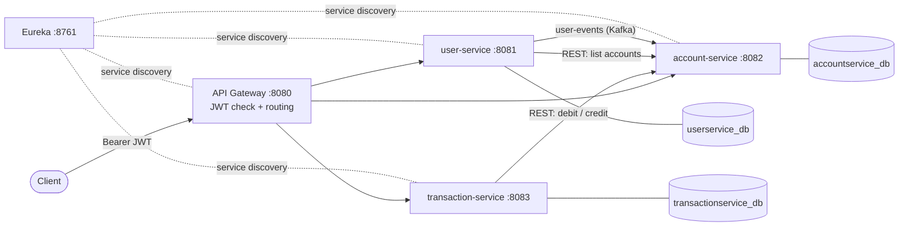

# 🏦 Bankify: Banking Microservices

A banking backend split into **user, account and transaction microservices**, each with its own
PostgreSQL database. Services find each other through **Eureka**, clients come in through a
**Spring Cloud Gateway** that checks **JWT** tokens, and **Apache Kafka** keeps data in sync across
the separate databases.


---

## Architecture



| Service | Owns | Responsibilities |
|---|---|---|
| **api-gateway** | | Single entry point. Serves the web page. Rejects requests without a valid JWT, routes through Eureka, forwards the verified user ID as `X-User-Id` |
| **user-service** | `userservice_db` | Sign-up and login (BCrypt passwords, JWT issuing), login history, publishes `USER_REGISTERED` to Kafka |
| **account-service** | `accountservice_db` | Accounts and balances; keeps a local copy of users from Kafka to validate account owners |
| **transaction-service** | `transactionservice_db` | Deposits, withdrawals and transfers with a full history, including failed attempts |
| **eureka-server** | | Service registry |

### Design decisions

- **Database per service.** No service reads another's tables. When account-service needs to know
  whether a user exists, it checks its own `account_owners` table, which a **Kafka consumer** fills
  from user-service's `user-events` topic. Account creation keeps working even when user-service is down.
- **Balances can't race or overdraw.** A balance change is a single SQL statement:
  `UPDATE … SET balance = balance + :amount WHERE … AND balance + :amount >= 0`. Two simultaneous
  withdrawals can't both pass a "check, then update" gap, and a debit can never take an account below zero.
- **Transfers use a compensating action.** The debit and credit are separate calls to account-service,
  so there is no shared database transaction. If the credit is rejected, the debit is reversed. If a call
  times out, the money may have moved, so nothing is refunded and the transaction stays `PENDING` for
  checking. If the refund itself fails, the transaction is marked `REFUND_FAILED` and logged for manual correction, so money
  is never silently lost.
- **Users only reach their own data.** The gateway forwards the verified user ID, and each service checks it.
  Someone else's account answers `404`, the same as a missing one. Balance changes are an internal
  endpoint that the gateway does not route.
- **The history explains every balance.** Accounts open empty, and money only moves through transaction-service.
- **Money is `BigDecimal`** with `NUMERIC(19,2)` columns, never floating point.
- **Passwords** are stored as BCrypt hashes and are never returned by the API.

---

## Run it

Requires Docker only; the services compile inside their containers.

```bash
docker compose up --build
```

This starts Postgres (with three databases), Kafka, Eureka, the three services and the gateway.
The first build takes a few minutes. When everything is up, the services appear on the Eureka
dashboard at http://localhost:8761.

Open **http://localhost:8080** for the web page: sign up, open accounts, deposit, withdraw, transfer
and see the history. It is plain HTML, CSS and JavaScript, served by the gateway.

### Try it from the terminal

```bash
# 1. Sign up and log in (the only endpoints that work without a token)
curl -s -X POST localhost:8080/api/auth/register -H 'Content-Type: application/json' \
     -d '{"username":"asha","email":"asha@example.com","password":"correct-horse"}'
TOKEN=$(curl -s -X POST localhost:8080/api/auth/login -H 'Content-Type: application/json' \
     -d '{"username":"asha","password":"correct-horse"}' | sed 's/.*"token":"\([^"]*\)".*/\1/')
AUTH="Authorization: Bearer $TOKEN"

# 2. Open two accounts (the user was synced to account-service through Kafka)
curl -s -X POST localhost:8080/api/accounts -H "$AUTH"
curl -s -X POST localhost:8080/api/accounts -H "$AUTH"

# 3. Put money in, then move it (use the account numbers returned above)
curl -s -X POST localhost:8080/api/transactions/deposit -H "$AUTH" -H 'Content-Type: application/json' \
     -d '{"accountNumber":"BNK…","amount":500}'
curl -s -X POST localhost:8080/api/transactions/transfer -H "$AUTH" -H 'Content-Type: application/json' \
     -d '{"sourceAccountNumber":"BNK…","destinationAccountNumber":"BNK…","amount":120.50}'
```

### API

| Method | Path | Notes |
|---|---|---|
| `POST` | `/api/auth/register` | `{username, email, password}` with a password of 8+ characters. **No token needed** |
| `POST` | `/api/auth/login` | Returns `{token, userId, expiresInSeconds}`. **No token needed** |
| `GET` | `/api/users/me`, `/api/users/me/accounts` | |
| `POST` | `/api/accounts` | No body. Opens an empty account for the caller; the number is generated (`BNK` + 10 digits) |
| `GET` | `/api/accounts`, `/api/accounts/{id}`, `/api/accounts/number/{n}` | Own accounts only |
| `POST` | `/api/transactions/deposit`, `/api/transactions/withdraw` | `{accountNumber, amount}`. Own account only; at most 2 decimals |
| `POST` | `/api/transactions/transfer` | `{sourceAccountNumber, destinationAccountNumber, amount}`. The source must be your own |
| `GET` | `/api/transactions/{id}`, `/api/transactions/account/{n}` | Own accounts only, newest first |
| `GET` | `/api/transaction-types` | `DEPOSIT`, `WITHDRAWAL` and `TRANSFER` |

Errors come back as HTTP status codes with a message: `400` invalid input, `401` missing or
invalid token, `404` unknown account (or someone else's), `409` insufficient funds or duplicate user,
`503` account-service unreachable or a transaction's outcome is unknown.

Each service also serves Swagger UI at `/swagger-ui.html` on its own port, for local development.

---

## Tests

```bash
./mvnw verify        # needs JDK 21; runs every service's tests against in-memory H2
```

26 tests run in total. They cover:
- the real overdraft-safe balance SQL
- transfer refunds when a credit fails, and the `REFUND_FAILED` case
- password hashing and JWT issuing
- the gateway rejecting missing, forged and expired tokens
- the Kafka user sync
- ownership checks, and that a credit with an unknown outcome is never refunded

## Kubernetes

```bash
docker compose build                 # builds images named bankify-<service>
kubectl apply -f k8s/bankify.yaml    # namespace, secret, Postgres, Kafka, Eureka, services, gateway
```

Change the values in the `bankify-secrets` Secret before deploying anywhere real.

## Configuration

| Variable | Used by | Default |
|---|---|---|
| `JWT_SECRET` | user-service, api-gateway | a local-development value (32+ characters required) |
| `DB_URL`, `DB_USER`, `DB_PASSWORD` | user, account and transaction services | `localhost:5432/<service>_db`, `postgres`, `postgres` |
| `EUREKA_URL` | all clients | `http://localhost:8761/eureka` |
| `KAFKA_SERVERS` | user-service, account-service | `localhost:9092` |

## Limitations and next steps

- Requests carry no idempotency key, so retrying one moves the money again.
- Deposits simulate cash coming in: there is no teller or payment provider behind them.
- The services trust `X-User-Id` from inside the private network, so only the gateway may be exposed.
- Transfers use compensation rather than an outbox or saga log, so a crash between debit and
  credit needs the `REFUND_FAILED` and `PENDING` records to be reconciled.
- The services are only published through the gateway in Docker. Running them directly exposes their ports.

## Author

**Thanush Raju Kaneshan**: [LinkedIn](https://www.linkedin.com/in/thanush-raju-kaneshan/) · [GitHub](https://github.com/Thanush-RajuKaneshan)

Started as a college team project with [Armaan Shah](https://github.com/Armaanshah32).
